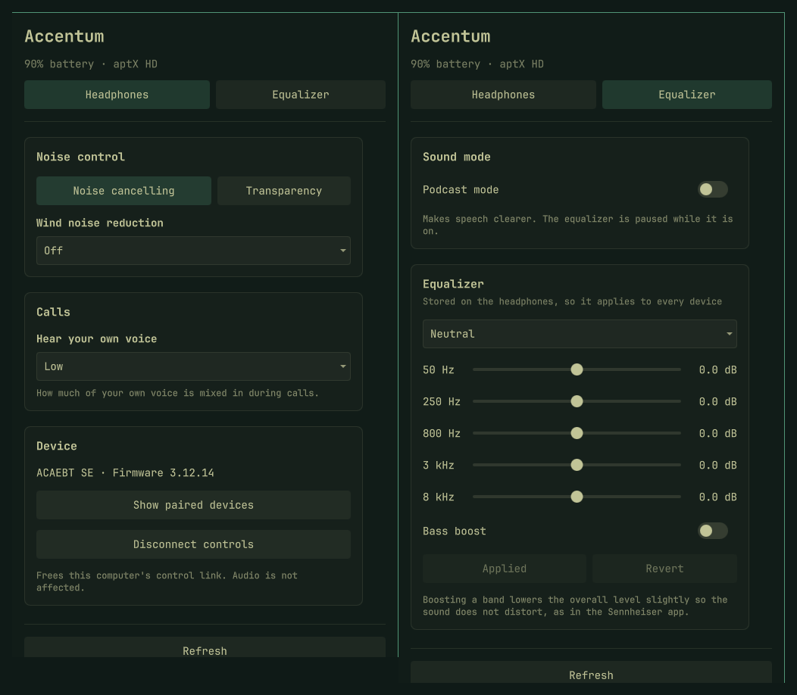

# Accentum Control for Omarchy

An unofficial Omarchy top-bar widget for Sennheiser ACCENTUM headphones: noise
control, the five-band equalizer, podcast mode and call settings, plus battery
and codec at a glance.

This is a modified fork of
[phi0x/omarchy-sennheiser-control](https://github.com/phi0x/omarchy-sennheiser-control),
which targets the HDB 630 and BTD 700. It is not the original author's release.
It is not affiliated with Sennheiser or Sonova.



> **No warranty — use at your own risk.** This software talks to your headphones
> with a reverse-engineered protocol. See [LICENSE.md](LICENSE.md) for the full
> disclaimer.

## Supported hardware

| Headphones | Firmware | Status |
|---|---|---|
| ACCENTUM Wireless (`ACAEBT`, including the SE) | 3.12.14 | Tested |
| ACCENTUM Wireless | 3.16.4 and later | Equalizer will not work (see below) |
| ACCENTUM Plus, other Sennheiser models | — | Not supported |

Firmware 3.16.4 switches the ACCENTUM to a different equalizer command set that
this widget does not implement. Noise control and call settings should be
unaffected, but that is untested.

## What it controls

- **Noise control:** noise cancelling or transparency, and wind noise reduction
  (off, automatic, maximum).
- **Equalizer:** five bands (50 Hz, 250 Hz, 800 Hz, 3 kHz, 8 kHz) from −6 to
  +6 dB, the Sennheiser presets, and bass boost. The equalizer is stored on the
  headphones, so it applies to every device they play from.
- **Podcast mode:** on or off. Your equalizer is restored when it is turned off.
- **Calls:** how much of your own voice you hear (off, low, high).
- **Read-only:** battery, charging state, codec, firmware, and the list of
  devices the headphones are paired with.

## Requirements

Omarchy with the Quickshell plugin system, Python 3.12+, `python-dbus`, `bluez`,
`bluez-libs` and `gcc`:

```
omarchy pkg add python python-dbus bluez bluez-libs bluez-utils gcc
```

The headphones must be paired with **this computer's own Bluetooth adapter**.
The control link does not pass through a USB audio dongle such as the BTD 600.
If you use a dongle for audio, pair the headphones with the computer as well;
that uses both of the headphones' multipoint slots.

## Install

```
omarchy plugin add https://github.com/chadsbrown/omarchy-accentum-control.git --enable
```

Click the headphones icon in the bar. On first use the widget connects to the
paired ACCENTUM automatically and compiles a small Bluetooth service-discovery
helper from `native/sdp-channel.c` into `~/.cache/accentum-control/`. Nothing
runs as root.

Update with `omarchy plugin update chadsbrown.accentum`, remove with
`omarchy plugin remove chadsbrown.accentum`.

## Using it

Switches and dropdowns on the Headphones tab apply immediately. On the Equalizer
tab, move the sliders or pick a preset, then press **Apply to headphones**.

Boosting a band lowers the overall level slightly so the sound does not
distort. This is the same loudness and headroom compensation the Sennheiser app
applies on this model.

Settings are read when the panel opens, after a change, and on **Refresh**.
They are not polled in the background, because bulk queries can disturb
playback. Changes made from the phone app show up after a refresh.

### From the command line

```
omarchy-shell accentum-control showTab eq
omarchy-shell accentum-control set transparency 1     # 0 = noise cancelling
omarchy-shell accentum-control set anti_wind 2        # 0 off, 1 maximum, 2 automatic
omarchy-shell accentum-control set sidetone 0         # 0 off, 1 low, 2 high
omarchy-shell accentum-control set audio_mode 2       # 1 equalizer, 2 podcast
omarchy-shell accentum-control preset Rock
omarchy-shell accentum-control status                 # JSON snapshot
```

These work once the panel has been opened in the current shell session, which
is what starts the controller.

## How it works

The headphones speak Qualcomm's GAIA v3 protocol with Sennheiser's vendor
commands over a Bluetooth Classic RFCOMM channel. One Python controller owns
that connection and is shared by the widget on every monitor through a private
Unix socket. The widget sends it one JSON request per line and receives state
snapshots back.

This firmware's equalizer does not store five slider values. It stores a master
gain and four cascaded high-shelf filters, a level shift and a flags word.
`backend/eq.py` converts between that and the five gains you see, and its tests
check the conversion against vectors produced by the official app's own code.

Podcast mode overwrites the equalizer stored on the headphones. The controller
remembers your last equalizer in `~/.local/state/accentum-control/eq.json` and
sends it again when podcast mode is turned off.

Device control is local. The widget makes no network requests.

## Development

```
python -m unittest discover -s tests -v
python -B backend/service.py        # line-delimited JSON worker; EOF on stdin stops it
```

Example request: `{"action":"setting","key":"transparency","value":1}`.

Saved QML changes may need `omarchy restart shell` before they take effect.

Do not sweep GAIA command ranges on real hardware. Some commands reset the
headphones, clear the pairing list or perform a factory reset.

## Credits and license

See [THIRD_PARTY.md](THIRD_PARTY.md) for the projects this builds on.

The project is source-available under the
[Sennheiser Control license](LICENSE.md), inherited from the upstream project:
you may use, modify and share it free of charge, but not sell it.
`backend/headphones.py` and `backend/eq.py` are MIT-licensed as noted in
THIRD_PARTY.md.
